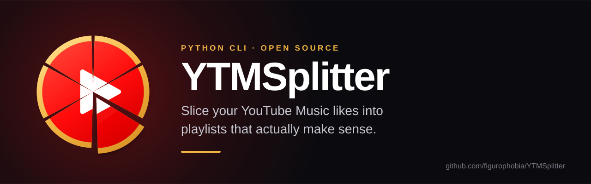
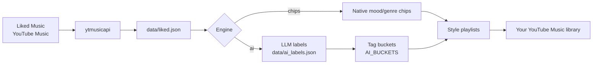

<div align="center">



# YTMSplitter

**Your Liked Music playlist is one big drawer. YTMSplitter turns it into playlists that make sense.**

[](https://github.com/figurophobia/YTMSplitter/actions/workflows/ci.yml)
[](LICENSE)
[](https://www.python.org/)
[](https://github.com/astral-sh/ruff)
[](CONTRIBUTING.md)

</div>

YTMSplitter reads your YouTube Music **Liked Music** playlist, classifies every
song and creates focused playlists in your library. It ships with two engines:

|  | **Chips** | **AI** |
|---|---|---|
| How it classifies | Uses the mood/genre chips YouTube Music already computes | Asks an LLM for a fine-grained style, then groups tags |
| API key | Not needed | Any OpenAI-compatible provider |
| Output | ~15 playlists such as Chill, Rock, Hip-hop | Under 10 playlists such as Video Games, Film/TV & Anime, Chillhop & Lo-fi |
| Best for | A quick, free split | Playlists that understand context and niche genres |

Both engines are **idempotent**: re-running them never duplicates a playlist.
`ai --update` adds only the songs you have liked since the last run.

---

## Quick start

**Requirements:** Python 3.10 or newer and a browser where you are signed in to
[YouTube Music](https://music.youtube.com).

### 1. Install

YTMSplitter is distributed from this repository; there is no PyPI release yet.
The easiest option is [pipx](https://pipx.pypa.io/), which keeps the CLI in its
own environment and puts it on your `PATH`:

```bash
pipx install "ytmsplitter[browsers] @ git+https://github.com/figurophobia/YTMSplitter.git"
```

<details>
<summary>Install with pip or from a clone</summary>

With pip (inside a virtual environment):

```bash
python -m venv .venv
source .venv/bin/activate        # Windows: .venv\Scripts\activate
pip install "ytmsplitter[browsers] @ git+https://github.com/figurophobia/YTMSplitter.git"
```

For development:

```bash
git clone https://github.com/figurophobia/YTMSplitter.git
cd YTMSplitter
python -m venv .venv
source .venv/bin/activate
pip install -e ".[dev,browsers]"
```

</details>

### 2. Split your library

```bash
# Reads cookies from Firefox, downloads Liked Music and shows the split.
# Nothing is created yet.
ytmsplitter quickstart

# Happy with the preview? Create the playlists.
ytmsplitter quickstart --create
```

That is the whole workflow. The default **chips** engine is free, fast and needs
no account beyond YouTube Music.

### 3. Prefer the AI engine?

```bash
export AI_API_KEY="sk-..."          # PowerShell: $env:AI_API_KEY = "sk-..."
export AI_MODEL="gpt-4o-mini"
ytmsplitter quickstart --engine ai --create
```

Any OpenAI-compatible endpoint works — see [AI configuration](#ai-configuration).

---

## Features

- **One-command onboarding** with `quickstart`.
- **Two engines**, so you can start without paying for an API.
- **Multi-browser cookie import** for Firefox, Chrome, Chromium, Brave, Edge,
  Opera, Vivaldi, LibreWolf and Safari, plus manual request headers.
- **Idempotent playlist creation** backed by `data/created_*.json`.
- **Incremental updates** with `ai --update`: only new likes are added.
- **Dry runs** everywhere: preview the result before touching your account.
- **Configurable buckets**: change playlist names and grouping in one file,
  without re-classifying anything.
- **Local-first data**: exports and session files stay in `data/`, which is
  gitignored.
- **No browser automation, no scraping hacks**: it uses the same internal API as
  the web player through [`ytmusicapi`](https://github.com/sigma67/ytmusicapi).

---

## How it works



### The chips engine

YouTube Music already tags your likes with native chips such as *Chill*,
*Focus*, *Rock* or *Video game music*. YTMSplitter fetches every chip and its
songs, then creates one playlist per chip. It is quick and free, but the buckets
are as broad as YouTube's own genres.

```bash
ytmsplitter chips                  # classify and preview
ytmsplitter chips --create         # create the playlists
ytmsplitter chips --create --dry-run
ytmsplitter chips --create --uncovered   # also include songs with no chip
```

### The AI engine

A model receives each song's **title, artists and album**, and returns one
fine-grained style from a closed set of 18 labels. YTMSplitter then groups those
labels into fewer than 10 playlists. This separates things generic genres miss:
game soundtracks from film soundtracks, or chillhop from vocal hip hop.

The taxonomy and the exact prompt live in [`prompts/classify.md`](prompts/classify.md)
and [`ytmsplitter/config.py`](ytmsplitter/config.py).

```bash
export AI_API_KEY="sk-..."
export AI_MODEL="gpt-4o-mini"

ytmsplitter ai                     # label + preview
ytmsplitter ai --create            # create the playlists
ytmsplitter ai --create --dry-run
ytmsplitter ai --create --privacy UNLISTED
ytmsplitter ai --update            # add new likes to existing playlists
```

You can skip the API entirely: classify the songs yourself with the prompt and
save the result as `data/ai_labels.json`. `ytmsplitter ai --create` will group
that file exactly the same way.

---

## Usage

### Authenticate

```bash
ytmsplitter auth                    # Firefox by default
ytmsplitter auth --browser chrome
ytmsplitter auth --browser brave
ytmsplitter auth --headers headers.txt
```

To use request headers, open `music.youtube.com` in your browser, go to
**DevTools → Network**, click a `browse` or `next` request, right-click it and
choose **Copy → Copy request headers**. Save them to a file and pass it with
`--headers`.

> Browser cookies expire. If a command suddenly reports `logged_in=0`, run
> `ytmsplitter auth` again. Chrome-based browsers should be fully closed while
> their cookie database is read.

### Check everything

```bash
ytmsplitter doctor
```

It reports the Python version, data directory, session status, cached library,
AI labels, created playlists and AI configuration, with a suggested next step.

### Refresh your library

```bash
ytmsplitter export
ytmsplitter ai --update
```

`export` downloads the current Liked Music playlist. `ai --update` compares each
existing playlist with its ideal group and adds only the missing songs. It never
recreates or empties a playlist.

### Commands

| Command | What it does |
|---|---|
| `ytmsplitter quickstart` | Authenticate, download likes and classify in one go |
| `ytmsplitter auth` | Create or refresh `data/auth.json` |
| `ytmsplitter doctor` | Diagnose session, data and playlist state |
| `ytmsplitter export` | Download Liked Music to `data/liked.json` |
| `ytmsplitter chips` | Classify with YouTube Music's native chips |
| `ytmsplitter ai` | Classify with an LLM and group songs into playlists |

### Flags

| Flag | Applies to | Meaning |
|---|---|---|
| `--create` | `quickstart`, `chips`, `ai` | Create the playlists |
| `--dry-run` | `quickstart`, `chips`, `ai` | Show the result without changing your account |
| `--privacy PRIVATE\|UNLISTED\|PUBLIC` | `quickstart`, `chips`, `ai` | Playlist visibility (default: `PRIVATE`) |
| `--update` | `quickstart`, `ai` | Add only missing songs to existing playlists |
| `--uncovered` | `quickstart`, `chips` | Add a playlist for songs that no chip covers |
| `--delete-old-chips` | `quickstart`, `ai` | Delete `Liked · …` playlists before creating AI ones |
| `--yes` | `quickstart`, `ai` | Confirm destructive actions |
| `--refresh` | `quickstart` | Download Liked Music again even if cached |
| `--browser NAME` | `quickstart`, `auth` | Browser to read cookies from |
| `--headers FILE` | `auth` | Use request headers instead of browser cookies |
| `--model`, `--base-url`, `--api-key` | `quickstart`, `ai` | Override AI environment variables |

Every command supports `--help`:

```bash
ytmsplitter --help
ytmsplitter ai --help
```

If the `ytmsplitter` command is not on your `PATH`, the module entry point works
too:

```bash
python -m ytmsplitter doctor
```

---

## AI configuration

YTMSplitter speaks the OpenAI Chat Completions protocol. Point it at any
compatible provider with three environment variables:

| Variable | Default | Purpose |
|---|---|---|
| `AI_API_KEY` | — | Provider API key |
| `AI_MODEL` | — | Model name, for example `gpt-4o-mini` |
| `AI_BASE_URL` | `https://api.openai.com/v1` | API endpoint |
| `AI_TIMEOUT` | `180` | Request timeout in seconds |

Examples:

```bash
# OpenAI (default endpoint)
export AI_API_KEY="sk-..."
export AI_MODEL="gpt-4o-mini"

# OpenRouter
export AI_BASE_URL="https://openrouter.ai/api/v1"
export AI_API_KEY="sk-or-..."
export AI_MODEL="vendor/model-name"

# Groq
export AI_BASE_URL="https://api.groq.com/openai/v1"
export AI_API_KEY="gsk_..."
export AI_MODEL="model-name"

# Ollama, running locally (no real key required)
export AI_BASE_URL="http://localhost:11434/v1"
export AI_API_KEY="local"
export AI_MODEL="llama3.1"

# LM Studio, running locally
export AI_BASE_URL="http://localhost:1234/v1"
export AI_API_KEY="local"
export AI_MODEL="model-name"
```

Use a model with reliable instruction following and JSON output. Smaller models
work, but may need more retries and produce more `other` labels.

### Custom playlists

Fine-grained labels and their grouping are configuration, not code. Edit
`AI_BUCKETS` in [`ytmsplitter/config.py`](ytmsplitter/config.py):

```python
AI_BUCKETS = {
    "Video Games": ["game_ost"],
    "Film, TV & Anime": ["film_tv_ost", "anime_jp", "classical_orchestral"],
    "Chillhop & Lo-fi": ["chillhop_lofi"],
    # ...
}
```

Then re-run `ytmsplitter ai --create`. Existing labels are reused; there is no
need to call the model again. If you change the names of buckets that already
exist, add an entry to `LEGACY_AI_BUCKETS` so `--update` can still find the old
playlists.

The chips engine's playlist names live in `PLAYLIST_NAMES`, next to
`CHIPS_PREFIX`.

---

## Data and privacy

Everything YTMSplitter stores lives in `data/` (configurable with
`YTMSPLITTER_DATA`):

```text
data/
  auth.json            YouTube session — secret, chmod 600, gitignored
  liked.json           every song in Liked Music
  chips.json           native chips found on the Liked Music page
  by_chip/<label>.json songs belonging to each chip
  uncovered_ids.json   liked songs that no chip covers
  summary.json         coverage summary
  ai_labels.json       fine-grained style assigned by the model
  ai_buckets.json      final grouping (labels → playlists)
  created_chips.json   playlist IDs created by the chips engine
  created_ai.json      playlist IDs created by the AI engine
```

- `data/` is gitignored, including `auth.json` and request headers.
- `auth.json` is written with permissions `600`.
- The chips engine sends nothing to a third party: it uses YouTube Music and
  local files only.
- The AI engine sends song metadata (title, artists, album) to the endpoint you
  configure. It does not send your session, email or library history. Check your
  provider's privacy policy before using it.
- To keep separate accounts apart, point each one at its own directory:

```bash
YTMSPLITTER_DATA=~/.local/share/ytmsplitter/work ytmsplitter quickstart
```

### Backwards compatibility

Playlists created by version 1.0.0 with Spanish names (`Me gusta · …`,
`IA · Videojuegos`, …) keep working. YTMSplitter migrates the keys in
`data/created_ai.json` automatically and recognises the legacy chips prefix, so
`--update` updates the existing playlists instead of creating duplicates.

---

## Troubleshooting

| Symptom | Fix |
|---|---|
| `auth.json does not exist` | Run `ytmsplitter auth` or `ytmsplitter quickstart` |
| `logged_in=0` / session not authenticated | Cookies expired: run `ytmsplitter auth` again |
| `No YouTube cookies found in chrome` | Close Chrome fully; or use `--browser firefox`; or `--headers` |
| `No module named browser_cookie3` | `pip install "ytmsplitter[browsers]"` or `pip install browser_cookie3` |
| `no chips were found` | Refresh the session; the Liked Music page may also have changed |
| `Missing data/liked.json` | Run `ytmsplitter export` |
| AI returns `401` | Check `AI_API_KEY`; some providers need a different base URL |
| AI returns `404` | Check `AI_MODEL` and `AI_BASE_URL` |
| AI is slow or times out | Increase `AI_TIMEOUT` or use a faster model |
| `--delete-old-chips` refuses to run | Re-run with `--yes`; use `--dry-run` first |
| `ytmsplitter: command not found` | Activate the virtual environment, check your pipx PATH, or use `python -m ytmsplitter` |
| Duplicate playlists appear | You renamed playlists manually; delete the duplicates or clear `data/created_*.json` and re-create |

Still stuck? Run `ytmsplitter doctor` and open an issue with the output, after
removing cookies and tokens.

---

## FAQ

**Does it modify or delete my Liked Music?**
No. It only reads Liked Music and creates or updates other playlists.

**Can I undo it?**
Yes. Delete the generated playlists in YouTube Music. Nothing else is touched.

**Does it work with YouTube instead of YouTube Music?**
No. It targets the YouTube Music library and its internal API.

**How many songs can it handle?**
The export paginates through the whole playlist, and additions are sent in
batches of 100. Libraries with thousands of songs work fine.

**Do I need an AI key?**
No. The chips engine is free and is the default for `quickstart`.

**Are the playlists public?**
No. They are created as `PRIVATE` unless you pass `--privacy UNLISTED` or
`--privacy PUBLIC`.

**Does the AI see my whole account?**
No. It receives only the metadata (title, artists, album) of songs that still
need a label.

---

## Contributing

Contributions are welcome. Read [CONTRIBUTING.md](CONTRIBUTING.md) for the
development setup and guidelines, and [CODE_OF_CONDUCT.md](CODE_OF_CONDUCT.md)
for community expectations.

```bash
pip install -e ".[dev,browsers]"
pytest
ruff check .
```

Security issues should be reported privately; see [SECURITY.md](SECURITY.md).

---

## License

[MIT](LICENSE) © 2026 David Sánchez Míguez

Release notes live in [CHANGELOG.md](CHANGELOG.md).

## Disclaimer

YTMSplitter is an unofficial project and is not affiliated with Google,
YouTube or YouTube Music. It uses the same internal API as the web player
through `ytmusicapi`, which may change without notice. Use it at your own risk
and in accordance with YouTube's terms of service.

The logo is an original illustration inspired by the YouTube Music play icon,
not an official YouTube Music asset.
